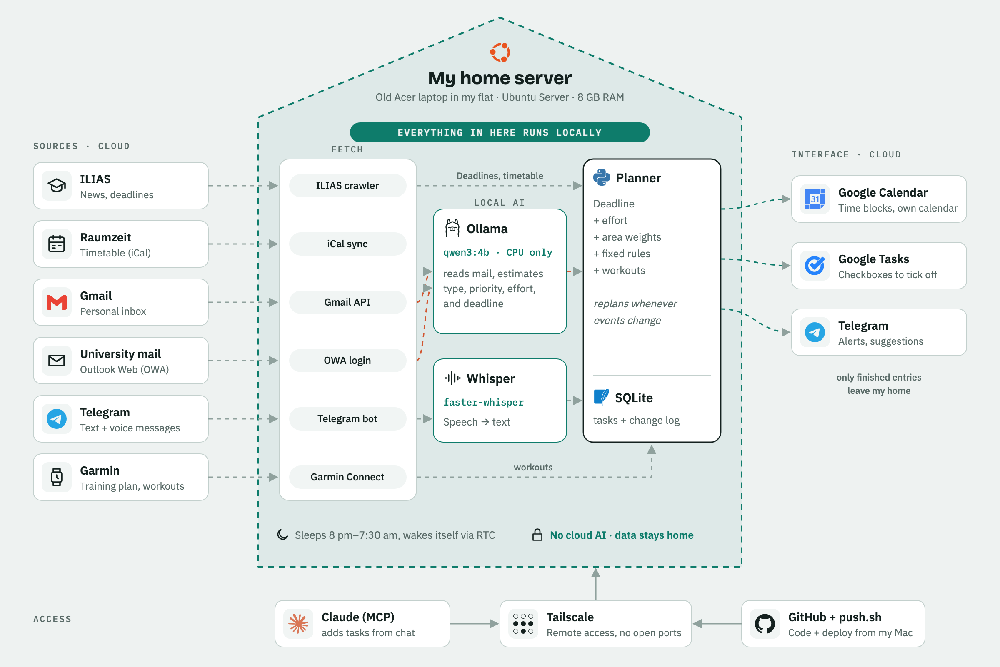
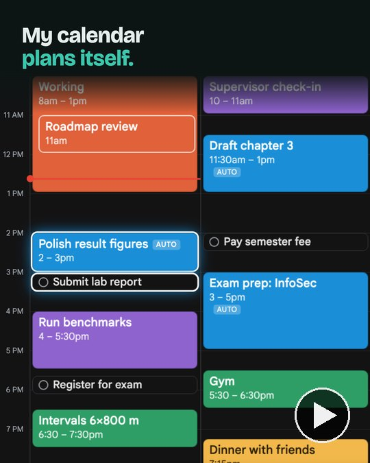

# calendar-assistant

**My calendar plans itself, on an old laptop at home.**

A self-hosted planning assistant. It reads my university portal, timetable, email and Telegram voice notes, turns them into tasks and schedules them as time blocks in Google Calendar. When something changes (a lab is cancelled, a new deadline shows up), it replans on its own. Everything runs on a home server, a recycled Acer laptop, with a local AI model: no cloud AI, and email content never leaves my home.

<picture>
  <source media="(prefers-color-scheme: dark)" srcset="docs/media/architecture-dark.png">
  
</picture>

## Demo

<a href="docs/media/demo.mp4"></a>

A 23-second clip ([docs/media/demo.mp4](docs/media/demo.mp4)): a lab gets cancelled, the planner drops two tasks into the free slot, then the camera walks through the architecture. The calendar in the video is a made-up demo week.

## What I get out of it

- **One interface.** I only work in Google Calendar. Tasks appear there as time blocks in a separate "Planer" calendar, each with a native checkbox task.
- **Nothing gets lost.** Every task and every automatic action is recorded in a change log. When a fixed event moves or disappears, the planner reschedules.
- **I stay in control.** Real tasks (someone expects something from me by a date) are scheduled automatically. Nice-to-know items (events, talks, offers) only arrive as suggestions on Telegram and reach the calendar once I confirm them.
- **Voice in, plan out.** A Telegram voice note like "submit the report by Friday, about two hours" becomes a task after one tap.

## How it works

| Part | What it does |
|---|---|
| **Fetch** | Connectors poll each source: ILIAS news (files, forum posts), the personal timetable feed (iCal), Gmail (API, read-only), university mail (Outlook Web Access), Telegram (long polling). |
| **Local AI** | [Ollama](https://ollama.com) with `qwen3:4b` on the CPU reads emails and decides: task, suggestion or nothing; it copies the deadline phrase verbatim and estimates priority and effort. [faster-whisper](https://github.com/SYSTRAN/faster-whisper) turns voice notes into text. |
| **Deadlines** | Dates are computed by code (`deadlines.py`), not by the model: "by Friday 7 pm", "until the next lecture" and similar phrases are resolved against the timetable. |
| **Planner** | Scores every open task by deadline, remaining effort and area weight, then places blocks greedily into free slots under configurable rules. Today and tomorrow stay stable; manual moves in the calendar are pinned and never overridden. |
| **Store** | SQLite holds tasks, areas, rules, links to calendar events and the append-only change log. |
| **Output** | Google Calendar (time blocks), Google Tasks (checkboxes inside each block), Telegram (alerts, suggestions, feedback buttons). |
| **Access** | A small MCP server lets Claude add tasks and suggestions from a chat. Remote access goes through Tailscale, so no port is open to the internet. |

### Sources

| Source | Status |
|---|---|
| ILIAS (university portal) | live: deadlines from files and forum posts become tasks automatically |
| Timetable (Raumzeit iCal) | live: changes trigger replanning |
| Gmail | live, opt-in (`GMAIL_ENABLED=1`) |
| University mail (OWA) | live, opt-in (`MAIL_ENABLED=1`) |
| Telegram text and voice | live |
| Garmin (training plan, workouts) | planned |

## Privacy

- Email bodies and voice messages are only processed on the home server. They are never sent to a cloud AI service.
- The database stores email metadata and the model's verdict, plus short excerpts only for emails I rated myself (used as few-shot examples, kept locally).
- Ollama listens on localhost only. The services run without root, secrets live in `.env` (never committed).
- The Google Cloud project stays private in testing mode, so the Google login is renewed every 7 days; the bot reminds me.

## Planning logic

```
score = area weight × urgency(deadline, remaining effort) × manual factor
```

- Areas form a tree with weights (for example Work > Uni > Private); children override their parent.
- Urgency grows as the free time before the deadline shrinks relative to the remaining effort.
- Rules (working window, buffers, block sizes, planning horizon) live in `data/rules.toml`; see [`rules.example.toml`](rules.example.toml).
- Blocks are split into chunks (at least 30 minutes, at most 3 hours per task and day).
- Tasks that no longer fit before their deadline trigger a Telegram warning once a day.

## Running it

Requires Python 3.12 and [uv](https://docs.astral.sh/uv/).

```bash
uv sync
uv run planner login          # Google login (opens the browser)
uv run planner add "Write report" --deadline 20.11. --est 2h --area Uni
uv run planner plan           # schedule open tasks now
uv run planner run            # background service: sync loop + Telegram bot
uv run pytest                 # test suite
```

Other commands: `tasks`, `done`, `drop`, `status`, `log`, `area`, `propose`, `proposals`, `accept`, `reject`, `sync-raumzeit`, `ilias-sync`, `mail-sync`, `voice-test`, `mcp`. Run `uv run planner --help` for the full list.

Configuration goes into `.env` (Google OAuth client, Telegram bot token and user ID, feed URLs, opt-in flags). The server setup (Ubuntu Server on the laptop, systemd units, hardening, Tailscale, nightly sleep from 8 pm to 7:30 am with RTC wake-up) is described step by step in [`deploy/README.md`](deploy/README.md).

## Repository layout

```
src/planner/           application code
  connectors/          ILIAS, timetable (iCal), Gmail, OWA mail
  scheduler.py         greedy planner
  planning.py          sync between tasks, blocks and the calendar
  llm.py, voice.py     local model and speech-to-text
  telegram_bot.py      bot (text, voice, buttons)
  mcp_server.py        tools for Claude
tests/                 pytest suite
deploy/                server setup scripts and systemd units
docs/KONZEPT.md        design notes and decisions (German)
docs/media/            diagram and demo video
```

## Status

Running daily on the home server since October 2026.

Next up:
- Garmin training plans as a source
- `/undo` in the bot
- learning effort estimates from actual time spent
- a constraint solver (OR-Tools CP-SAT) as planner v2
- encrypted database backups

The design notes in [`docs/KONZEPT.md`](docs/KONZEPT.md) and the deployment guide are written in German.
